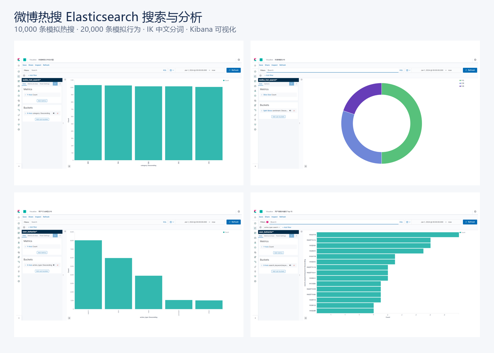

# 微博热搜 Elasticsearch 搜索与分析 Demo

基于 Elasticsearch 7.17、IK 中文分词、Kibana 和 Python 的搜索练习项目，包含索引 Mapping、Bulk 导入、全文检索、聚合分析、地理查询和本地图表分析。



## 数据与边界

- `data/weibo_hot_search.json`：10,000 条模拟热搜，ID 唯一。
- `data/user_behavior.json`：20,000 条模拟用户行为，ID 唯一。
- 数据仅用于功能演示，不是实时抓取的微博数据，不用于推断真实用户或舆情结论。
- 默认单节点、单分片、零副本，目标是本地可复现，不宣称生产级分布式部署。

## 一键启动与初始化

要求 Docker Compose 和 Python 3.10+。Python 初始化脚本只使用标准库。

```bash
docker compose up -d --build
python scripts/setup_es.py
```

脚本会依次完成：

1. 从 JSON Lines 生成两份 Bulk 文件；
2. 等待 Elasticsearch 就绪；
3. 创建 `weibo_hot_search` 和 `user_behavior` 索引；
4. 分批 Bulk 导入并检查 `errors`；
5. 校验两个索引分别为 10,000 和 20,000 条。

访问：

- Elasticsearch：<http://localhost:9200>
- Kibana：<http://localhost:5601>

重复执行会按文档 ID 覆盖写入，不会重复增加文档；已有索引的 Mapping 不会被自动改写。

只验证 Bulk 生成、不连接服务：

```bash
python scripts/setup_es.py --convert-only
```

停止服务：

```bash
docker compose down
# 如需同时删除本地索引数据
# docker compose down -v
```

## 查询与分析

- `postman/weibo_hotsearch.postman_collection.json`：39 个请求，覆盖索引管理、CRUD、全文查询、组合查询、聚合、地理查询和用户行为分析。
- `config/`：两份索引 Mapping，热搜索引使用 `ik_smart` 自定义分析器。
- `docs/kibana/`：原项目的 Kibana 图表参考。

Postman 批量导入请求引用 `data/bulk_*.json`，因此先运行 `python scripts/setup_es.py --convert-only`。

## 本地图表分析

```bash
python -m venv .venv
# Windows
.venv\Scripts\activate
# macOS / Linux
source .venv/bin/activate

pip install -r requirements.txt
python scripts/analyze_behavior.py
python scripts/analyze_geo.py
```

结果写入 `docs/charts/`。地理脚本使用 Haversine 公式计算球面距离，用于与 Elasticsearch 地理查询结果相互印证。

## 验证

```bash
python -m unittest discover -s tests -v
python -m compileall -q scripts tests
```

测试覆盖真实记录数、ID 唯一性、Mapping 字段完整性、Bulk 格式与全量生成、39 个 Postman 请求及其 JSON 请求体。

## 后续可深入方向

当前仓库重点是可复现的搜索功能闭环。若用于进一步技术实验，可在相同数据集上对比 IK 分词、字段权重与排序策略，并记录查询延迟和相关性结果；未实际测量的性能数字不会写入项目说明。
